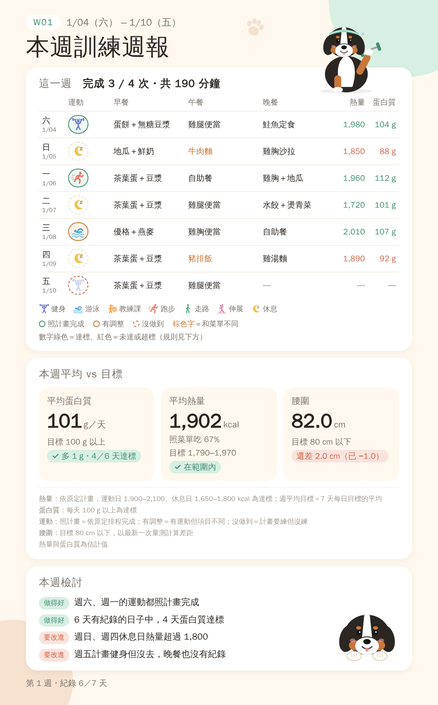

# health-coach-kit

讓你的 AI 助理（Claude、ChatGPT 或 Gemini）變成**飲食＋運動的紀錄小幫手**：

- 先問你一輪問題，幫你算出每天的熱量、蛋白質目標，排一份一週菜單
- 在你的 **Notion** 建好紀錄用的資料庫
- 白天吃了什麼，傳照片或打字給它，它估熱量和蛋白質後記下來
- **每天晚上**主動問你今天吃了什麼、運動了什麼（照菜單的先幫你選好）
- **每週**產生一張週報圖，可以直接傳給教練；吉祥物可以換成你家的寵物（拍照給 AI 參考）



> 範例圖裡的人物和數字都是虛構的；伯恩山是預設的吉祥物範例。

---

## 怎麼開始

1. 確認你有權限讀這個 repo（private repo，請擁有者把你加進來）
2. 建議先在你的 AI 連上 **Notion**（沒有 Notion 也可以用，但功能會少一些）
3. 開一個新對話，貼上這段話：

   > 請讀 https://github.com/xs04/health-coach-kit 的 AGENTS.md，照裡面的流程幫我設定。

4. 回答它的問題，大約 10–15 分鐘

### 用哪個 AI？

| | Claude | ChatGPT | Gemini |
|---|---|---|---|
| 詳細步驟 | [platforms/claude.md](platforms/claude.md) | [platforms/chatgpt.md](platforms/chatgpt.md) | [platforms/gemini.md](platforms/gemini.md) |
| 狀態 | ✅ 整套流程實際跑過 | ⚠️ 未實際測試 | ⚠️ 未實際測試 |
| 紀錄位置 | Notion | Notion（不能寫入時用 CSV） | 建議 Google 試算表；Gemini CLI 可接 Notion |
| 建議用法 | 安裝成 **Skill**（見下方），或給網址 | 放進「專案」 | 建立「Gem」，或用 Gemini CLI |

### Claude 使用者：安裝成 Skill

這個 repo 本身就是一個 Claude Skill（根目錄的 `SKILL.md`）。安裝後，說「幫我記一下午餐」「做這週的週報」這類話，Claude 就會自動使用。

- **Claude 網頁或 App**：下載 [`dist/health-coach-kit.skill`](dist/health-coach-kit.skill)，在設定的 Skills 頁面上傳
- **Claude Code**：把這個資料夾放到 `~/.claude/skills/health-coach-kit/`

---

## 隱私

- 你的身高體重、病史、飲食紀錄只會存在**你自己的** AI 對話和 Notion 裡，**不會**回到這個 repo
- 週報圖預設**不放**病史、檢驗數值和真實姓名
- 這個 repo 只放範本和說明，**不要**把任何人的真實資料 commit 進來

## 授權

[MIT License](LICENSE)：可以自由使用、修改、再分享，保留著作權聲明即可。

## 免責聲明

這是生活紀錄工具，**不是醫療服務**。AI 給的飲食和運動建議只是一般性參考，有慢性病、正在服藥、懷孕或受傷的人，請先和醫師或營養師討論。詳見 [safety.md](safety.md)。

## 檔案結構

```
SKILL.md               ← Claude Skill 的入口
AGENTS.md              ← 給 AI 的主要流程（ChatGPT、Gemini 從這裡開始）
CLAUDE.md、GEMINI.md   ← Claude Code、Gemini CLI 會自動讀，指回 AGENTS.md
safety.md              ← 安全守則（AI 必讀）
TESTING.md             ← 測試範本用的步驟（維護者、幫忙測試的人）
onboarding/questions.md← 設定時要問的問題
notion/schema.md       ← Notion 資料庫的欄位定義
prompts/               ← 每晚確認、每週週報的指令範本
platforms/             ← Claude、ChatGPT、Gemini 各自的設定步驟
weekly-card/           ← 週報圖的範本與產圖程式
dist/                  ← 打包好的 Claude Skill（由 scripts/build-skill.sh 產生）
```
